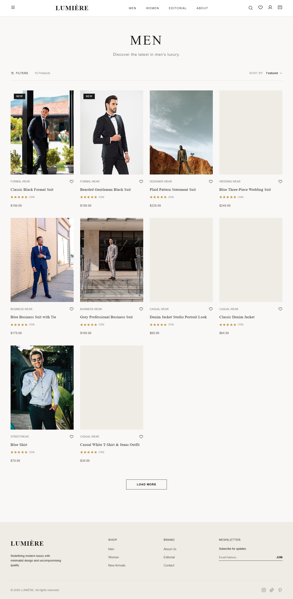
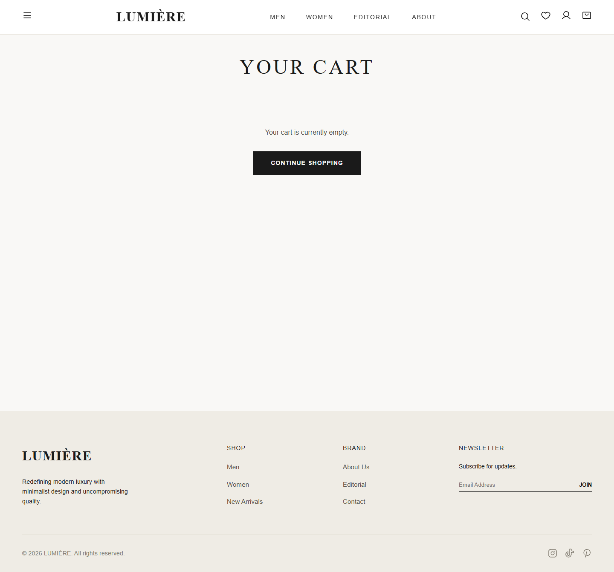
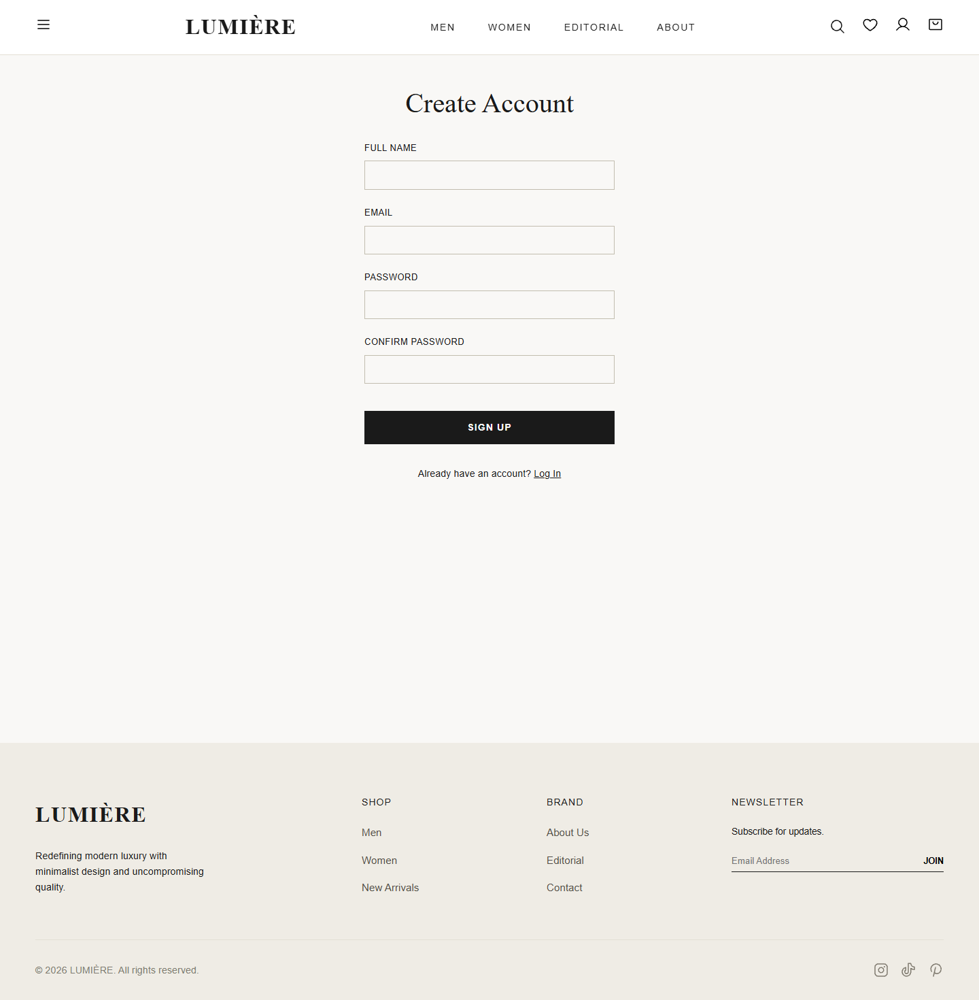

# Fashion E-Commerce Platform

A modern, full-stack Fashion E-Commerce web application built with **React 19**, **Vite**, and **InsForge** for backend services (PostgreSQL Database, Authentication, Storage, and Edge Hosting).

**Live Demo:** [https://gw9fatjz.insforge.site](https://gw9fatjz.insforge.site)

---

## Tech Stack
- **Frontend:** React 19, Vite, React Router v7
- **Backend (BaaS):** InsForge (PostgreSQL, GoTrue Auth, Storage)
- **Styling:** Custom CSS with luxury aesthetic principles (CSS Variables, Flexbox/Grid, Micro-animations)
- **Icons:** Phosphor Icons

---

## Key Features
1. **User Authentication:** Secure sign-up, login, and email OTP verification flow.
2. **Product Catalog:** Dynamic product rendering fetched from the PostgreSQL database with category filtering (Men, Women, Accessories).
3. **Product Details:** Individual product pages with size selection and expandable accordion sections for *Shipping & Returns* and *Materials & Care*.
4. **Shopping Cart:** Full cart management (add, remove, adjust quantity, real-time subtotal calculation).
5. **Wishlist:** Save favorite products for quick access.
6. **Checkout Flow:**
   - **Cash on Delivery (COD):** Seamless default checkout option.
   - **Bank Transfer:** Built-in file upload system for payment receipts stored via InsForge Storage.
7. **Responsive Design:** Mobile-first architecture optimized for desktop, tablet, and mobile viewports.

---

## Screenshots

### Home Page


### Men's Collection


### Shopping Cart


### User Registration


### About Page


---

## Local Development Setup

1. **Install Dependencies:**
   ```bash
   npm install
   ```

2. **Configure Environment Variables:**
   Create a `.env.local` file in the project root:
   ```env
   VITE_INSFORGE_URL=https://gw9fatjz.us-east.insforge.app
   VITE_INSFORGE_ANON_KEY=your_anon_key_here
   ```

3. **Start Development Server:**
   ```bash
   npm run dev
   ```
   Open `http://localhost:5173` in your browser.

---

## Author
**Rishav Ranjan**  
B.Tech — Electronics and Communication Engineering (ECE)  
Maharaja Agrasen Institute of Technology (MAIT), GGSIPU
